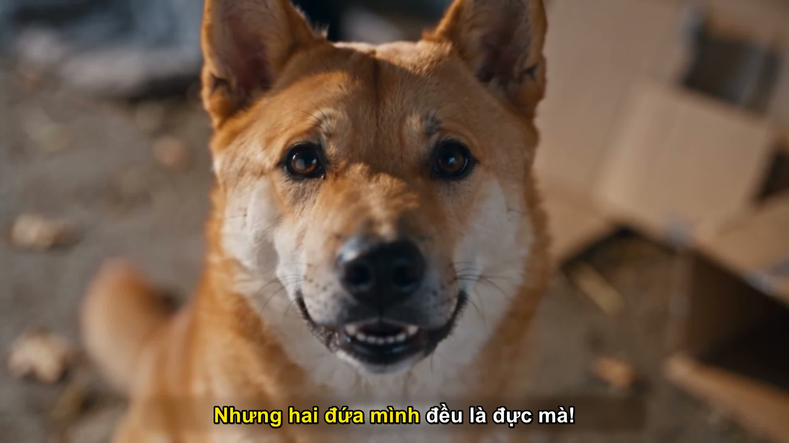
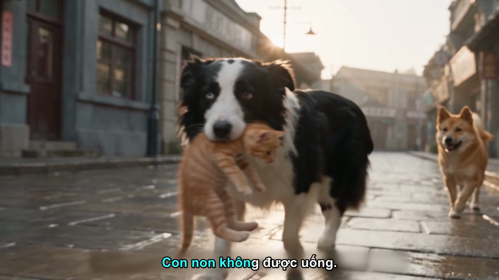

# Vietsub-video-Trung

Bộ **Skill, Workflow, Rule và Template** chuẩn Antigravity giúp tự động hóa trọn gói quy trình tải kênh video Trung / Douyin, nhận diện thoại tiếng Trung (`Whisper large-v3` + `RapidOCR`), dịch phân vai theo ngữ cảnh & cao độ giọng (`f0_hz`), lồng tiếng nhiều vai (`edge-tts`), tạo phụ đề Karaoke quét màu từng từ `\kf` và hòa trộn âm nền tự nhiên bằng **Smart Ducking `O(N)`**.

## Ảnh kiểm chứng thực tế (Pilot Karaoke `\kf`)

| Giọng Bố Chó (Vàng Hoàng Kim) | Giọng Anh Biên (Xanh Ngọc Sáng) |
|---|---|
|  |  |

*(Phụ đề hardsub tiếng Trung gốc được làm mờ gọn trong dải pill bo tròn bằng mặt nạ grayscale `"L"`, phụ đề Việt `\kf` quét màu chuẩn theo từng từ đọc thực tế của Microsoft TTS.)*

## Kiến trúc Pipeline 5 Bước

1. **Bước 1 — Tải toàn bộ kênh (`step1_download_channel.py`)**: Kết nối `MediaCrawler` + Playwright CDP lấy bài đăng theo `sec_uid`, đánh số thứ tự thời gian, phân loại tự động tập lẻ và hợp tập (`>= 600s` hoặc chứa từ khóa `合集`, `纯享`), xuất `raw/posts_manifest.json`.
2. **Bước 2 — Whisper GPU + F0 + RapidOCR (`step2_transcribe_ocr.py`)**: Chạy `faster-whisper` (`large-v3`, `CUDA float16`), tách segment con tại khoảng nghỉ `> 1.05s`, ước tính cao độ `f0_hz` từng câu và dùng `RapidOCR` trên dải crop đáy để xác định chính xác `hardsub_band`.
3. **Bước 3 — Dịch phân vai song song & QA Gate (`step3_workflow_translate.py` / `workflow_translate_qa.py`)**: Điều phối subagent dịch theo lô kết hợp `glossary.md` + `f0_hz`, sau đó chạy cổng QA kiểm tra 100% số câu, ký tự sót và giới hạn độ dài để không tràn slot.
4. **Bước 4 — TTS phân vai + Karaoke `\kf` + Smart Ducking (`step4_dub_karaoke_render.py`)**: Sinh giọng đọc `edge-tts` (`Hz` pitch, `WordBoundary` `/ 10_000_000.0`), căn chỉnh từ bằng `SequenceMatcher`, kẹp `atempo <= 1.48`, Smart Ducking `O(N)` (`0.85 -> 0.08`, ramp `90ms`), làm mờ hardsub và render `h264_nvenc` (fallback `libx264`).
5. **Bước 5 — Kiểm toán & Báo cáo (`step5_audit_report.py`)**: Chạy `ffprobe` kiểm tra toàn bộ `.mp4`, `.vi.srt`, `.vi.ass`, xác minh độ lệch thời lượng `< 0.6s`, thống kê dung lượng và xuất `BAO_CAO_SAN_XUAT.md`.

## Cấu trúc thư mục

```text
vietsub-video-trung/
├── README.md
├── AGENTS.md
├── .gitignore
├── assets/
│   ├── demo-karaoke-bo-cho.jpg
│   └── demo-karaoke-anh-bien.jpg
├── rules/
│   └── vietsub-video-trung.md
├── workflows/
│   ├── workflow_translate_qa.py
│   └── vietsub-karaoke-pipeline.md
├── skills/
│   └── vietsub-video-trung/
│       ├── SKILL.md
│       ├── scripts/
│       │   └── init_project.py
│       └── references/
│           └── technical-pitfalls.md
└── template/
    ├── project.example.json
    ├── glossary.example.md
    └── scripts/
        ├── config_loader.py
        ├── step1_download_channel.py
        ├── step2_transcribe_ocr.py
        ├── step3_workflow_translate.py
        ├── step4_dub_karaoke_render.py
        └── step5_audit_report.py
```

## Yêu cầu môi trường & phụ thuộc

- **Python**: `3.13+` (hoặc `3.10+`)
- **FFmpeg & FFprobe**: Bản có hỗ trợ `libass` và khuyến nghị GPU `h264_nvenc` (fallback tự động sang `libx264`).
- **Thư viện Python**: `faster-whisper`, `rapidocr-onnxruntime`, `edge-tts`, `numpy`, `Pillow` (cùng CUDA DLL từ `torch/lib` hoặc NVIDIA CUDA/cuDNN cho Bước 2).
- **Trình tải kênh (Bước 1)**: `MediaCrawler` (môi trường riêng có `playwright` và trình duyệt Chromium/CDP; chạy trong bước 1 bằng Python `.venv` của `MediaCrawler`, cần kết nối mạng tới Douyin).
- **Lồng tiếng TTS (Bước 4)**: Yêu cầu kết nối Internet để gọi Microsoft Edge TTS (`edge-tts`).

### Biến môi trường tùy chọn (Auto-Discovery)

`config_loader.py` tự dò công cụ theo thứ tự `ENV -> project.json["paths"] -> PATH (shutil.which) -> thư mục tương đối`:

| Biến môi trường | Ý nghĩa |
|---|---|
| `VIETSUB_PROJECT_DIR` | Thư mục dự án chứa `project.json` |
| `FFMPEG_BIN` / `FFPROBE_BIN` | Đường dẫn tới `ffmpeg` / `ffprobe` |
| `CUDA_TORCH_LIB` | Thư mục chứa CUDA DLL (`torch/lib`) cho `faster_whisper` |
| `MEDIACRAWLER_DIR` | Thư mục cài `MediaCrawler` |
| `WORK_ROOT` | Thư mục gốc chứa bộ công cụ chung (nếu có) |

## Cài đặt vào Antigravity cục bộ

1. Sao chép thư mục `skills/vietsub-video-trung/` (kèm bản sao `template/`, `workflows/`, `rules/` bên trong để tự đủ độc lập) vào `~/.gemini/config/skills/vietsub-video-trung/`.
2. Thêm từ khóa kích hoạt vào `~/.gemini/config/AGENTS.md`:
   ```markdown
   | vietsub-video-trung | "vietsub video trung", "vietsub douyin", "karaoke sub", "long tieng kenh trung", "dich kenh douyin" |
   ```

## Hướng dẫn chạy nhanh cho dự án mới

### 1. Khởi tạo dự án từ template

```bash
python skills/vietsub-video-trung/scripts/init_project.py \
  --slug ten-kenh-moi \
  --dest ./Du_an \
  --channel-url "https://www.douyin.com/user/<sec_uid>"
```

Chỉnh sửa `./Du_an/ten-kenh-moi/project.json` (cấu hình vai `roles`, ngưỡng hợp tập, thông số `ducking`/`karaoke`) và `./Du_an/ten-kenh-moi/glossary.md` (tên nhân vật, xưng hô).

### 2. Chạy tuần tự 5 bước

```bash
# Bước 1: Tải video kênh (dùng Python của MediaCrawler)
<mediacrawler-python> ./Du_an/ten-kenh-moi/scripts/step1_download_channel.py --project-dir "./Du_an/ten-kenh-moi"

# Bước 2: Nhận diện thoại Whisper GPU + đo f0_hz + dò hardsub RapidOCR
python ./Du_an/ten-kenh-moi/scripts/step2_transcribe_ocr.py --project-dir "./Du_an/ten-kenh-moi"

# Bước 3: Chạy /run-workflow với ./Du_an/ten-kenh-moi/scripts/step3_workflow_translate.py

# Bước 4A: Cổng Pilot 1 tập + trích 2 frame kiểm tra trực quan
python ./Du_an/ten-kenh-moi/scripts/step4_dub_karaoke_render.py --project-dir "./Du_an/ten-kenh-moi" --ep <ep_key_dau> --pilot-frames

# Bước 4B: Render tuần tự toàn bộ sau khi Pilot đạt chuẩn
python ./Du_an/ten-kenh-moi/scripts/step4_dub_karaoke_render.py --project-dir "./Du_an/ten-kenh-moi" --all

# Bước 5: Kiểm toán ffprobe & xuất BAO_CAO_SAN_XUAT.md
python ./Du_an/ten-kenh-moi/scripts/step5_audit_report.py --project-dir "./Du_an/ten-kenh-moi"
```

## 8 Điểm Thiết Kế Kỹ Thuật Cốt Lõi

- **Mặt nạ blur grayscale `"L"` (`fill=248`, `GaussianBlur(12)`)** kết hợp `format=gray` trước `alphamerge` giúp làm mờ gọn dải chữ Trung mà không bị lỗi nhòe toàn khung hình.
- **RapidOCR crop dải đáy** trên video 2K/4K rồi cộng bù tọa độ gốc tránh mất box chữ khi ảnh đầu vào quá lớn.
- **Tách pause `> 1.05s` theo word timestamps** của Whisper `large-v3` giúp không kéo nhạc dạo đầu vào thời điểm bắt đầu câu thoại.
- **Chuẩn hóa `edge-tts`**: `pitch` đơn vị `Hz`, `WordBoundary` chia `10_000_000.0`, warmup đủ toàn bộ giọng, retry 8 lần, kẹp `atempo <= 1.48`, khớp từ bằng `SequenceMatcher`.
- **An toàn đường dẫn Windows cho filter `ass=`** bằng `cwd=tmp_ep` và tên file tương đối.
- **Ưu tiên metadata gốc từ `_zh.json`** ở Bước 4 để tránh sai lệch nếu file dịch `_vi.json` bị chép nhầm kích thước.
- **Smart Ducking `O(N)`** bằng hai lượt boxcar `45ms` (`90ms` ramp) dìm nền từ `0.85` xuống `0.08` trong `< 1s/tập`.
- **Cổng Pilot 1 tập & dọn `_tmp/<ep_key>` ngay lập tức** giúp đảm bảo chất lượng thị giác/âm thanh và giữ trống ổ đĩa khi chạy hàng loạt.
